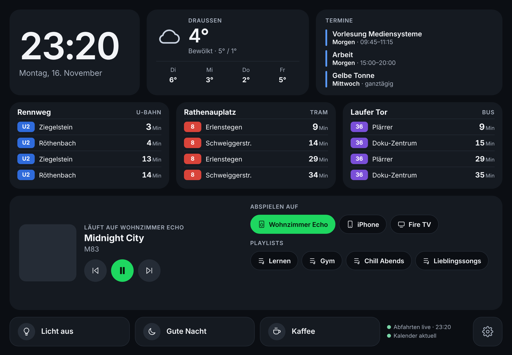

# homeview

iPad-Dashboard: Live-Abfahrten (VAG), Wetter, Kalender, Spotify und Kurzbefehle.

Läuft unter https://benditstr.github.io/homeview/

- `index.html`: das Dashboard (Einstellungen über das Zahnrad, werden nur lokal auf dem Gerät gespeichert)
- `kalender-worker.js`: Cloudflare Worker als Kalender-Proxy

Daten: VAG Echtzeit-API (CC BY 4.0), Open-Meteo
